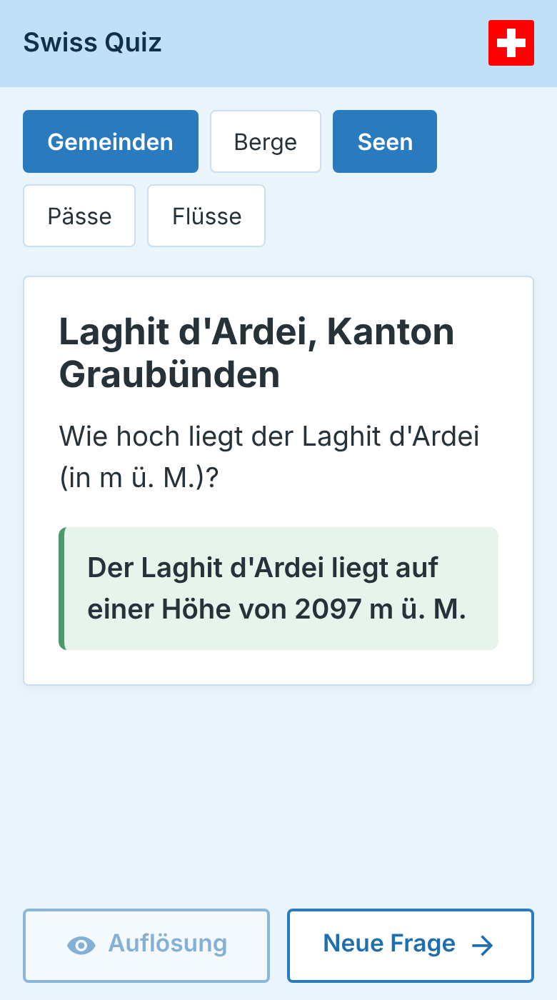

# swiss-geo

A geography quiz about Switzerland. 
Available as a web-app here: [swiss-geo.chrisbaumann.ch/](https://swiss-geo.chrisbaumann.ch/)

Data taken from [Wikipedia](https://de.wikipedia.org/wiki/) and https://schweizerfluss.ch/.
Scraping was done using Python, see code in [crawler](./crawler).

## Search engines

`index.html` has title and description (German), canonical address, Open Graph / Twitter card
(`static/social-card.png`) and structured data (`WebApplication`). `sitemap.xml` and `robots.txt` are in the
root, which is also the root of the domain `swiss-geo.chrisbaumann.ch`. The site can also be added in the
Google Search Console.
